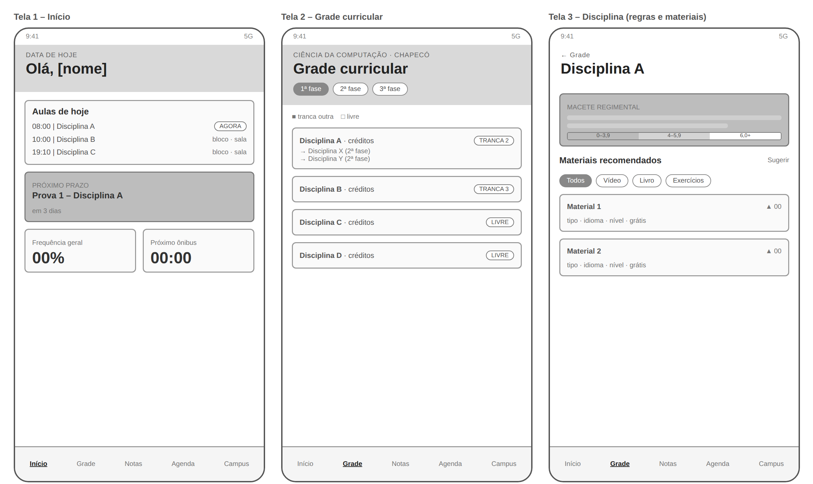
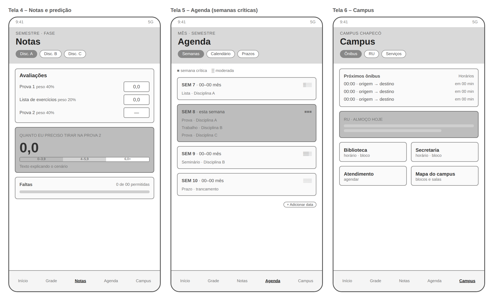
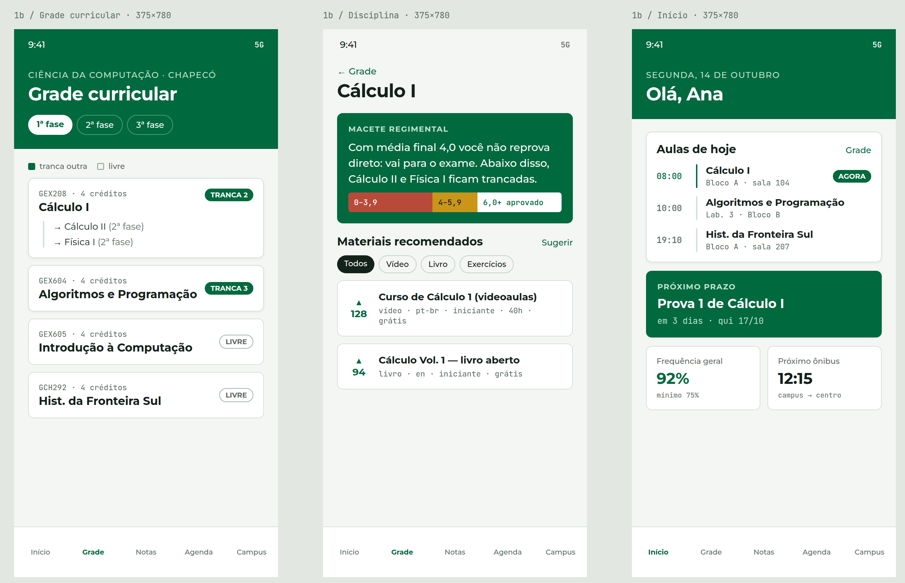
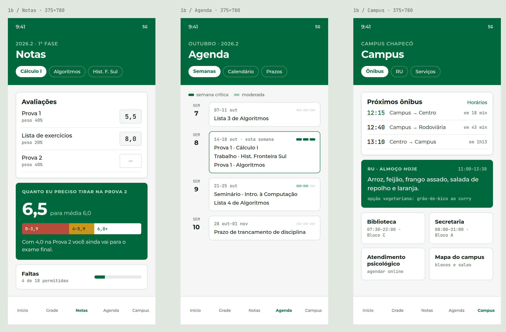

# Meu UFFS

Plataforma web de gestão individual e afiliação estudantil para ingressantes.

- **Curso de referência:** Ciência da Computação, Universidade Federal da Fronteira Sul (UFFS), Campus Chapecó
- **Público-alvo:** estudantes ingressantes (calouros) do ensino superior
- **Status:** Sprint 1, concepção do projeto (ainda sem código)
- **Relatório completo:** [`docs/sprint-1/Meu-UFFS_Sprint-1_Relatorio.docx`](docs/sprint-1/Meu-UFFS_Sprint-1_Relatorio.docx)
- **Padrão de commit:** [`docs/padrão-de-commit.md`](docs/padrão-de-commit.md)

Este README reúne as mesmas seções do relatório da Sprint 1.

## 1. Identificação

- **Título do projeto:** Meu UFFS: plataforma web de gestão individual e afiliação estudantil para ingressantes
- **Estudantes:** Guilherme Martins Souza e Marcos Vinicius Alcides da Costa
- **Curso e instituição:** Ciência da Computação, Universidade Federal da Fronteira Sul (UFFS), Campus Chapecó
- **ODS escolhido:** ODS 4, Educação de Qualidade, meta 4.3

## 2. Introdução e contextualização

O ingresso no ensino superior público é um momento de ruptura. O estudante deixa um ambiente escolar mais tutelado e passa a gerir sozinho notas, prazos, pré-requisitos e regras institucionais. O Censo da Educação Superior do INEP mostra o tamanho do problema. Entre os ingressantes de 2015 na educação superior brasileira, 13% já tinham desistido do curso ao fim do primeiro ano e 29% ao fim do segundo. Dez anos depois, a desistência acumulada chegou a 60% (INEP, 2025). Em cursos de Computação, as taxas de evasão também têm sido elevadas (Alvim; Bittencourt; Duran, 2024).

Coulon (2017) mostra que a entrada na universidade exige aprender o "ofício de estudante". Segundo o autor, estudantes que não se afiliam à instituição, isto é, que não dominam suas regras e seus códigos, tendem a fracassar academicamente.

A V Pesquisa Nacional de Perfil dos Graduandos das IFES mostra que o problema não é só pedagógico. Entre os estudantes ouvidos, 86,1% relataram alguma dificuldade estudantil, e 52,8% já pensaram em abandonar o curso (FONAPRACE; ANDIFES, 2019).

O problema que o projeto enfrenta é este: o calouro de Ciência da Computação da UFFS Chapecó precisa entender sozinho a estrutura do curso, as regras de aprovação e progressão, o cálculo de suas médias, o calendário de avaliações e a logística do campus. Essas informações estão espalhadas em documentos extensos, como o Projeto Pedagógico do Curso (PPC) e o Regulamento da Graduação, ou na transmissão informal entre veteranos.

Os dados do INEP citados acima se referem ao conjunto dos cursos de graduação. O recorte específico de Computação e TIC não consta na apresentação consultada e pode ser buscado depois nos Indicadores de Trajetória por curso.

## 3. Justificativa com base em evidências

A permanência no ensino superior depende de fatores que vão além do conteúdo das disciplinas. As evidências a seguir mostram que parte relevante desses fatores é de organização, informação e rotina, justamente onde uma plataforma web pode atuar.

- **Desistência concentrada nos primeiros anos.** Entre os ingressantes de 2015, a desistência acumulada foi de 13% no primeiro ano e 29% no segundo, e chegou a 60% no décimo ano (INEP, 2025). Quase metade da desistência final já havia ocorrido ao fim do segundo ano.
- **Dificuldades que afetam o desempenho.** A V Pesquisa do FONAPRACE e da ANDIFES apurou que 86,1% dos discentes das IFES têm alguma dificuldade estudantil. As mais citadas são falta de disciplina de estudo (28,4%), dificuldades financeiras (24,7%), carga excessiva de trabalhos estudantis (23,7%), problemas emocionais (23,7%) e tempo de deslocamento até a universidade (18,9%) (FONAPRACE; ANDIFES, 2019).
- **Pensamento de abandono.** 52,8% dos discentes já pensaram em abandonar o curso. Entre as razões, 29,7% apontam o nível de exigência acadêmica e 23,6% a dificuldade de conciliar estudo e trabalho (FONAPRACE; ANDIFES, 2019).
- **Afiliação institucional.** Coulon (2017) defende uma "pedagogia da afiliação". Para ele, o sucesso no primeiro ano depende de o estudante aprender as regras e os códigos da vida universitária.
- **Evasão em Computação.** Alvim, Bittencourt e Duran (2024) analisaram microdados do Censo da Educação Superior de 2015 a 2019. Eles tratam a evasão nos cursos de Computação como um problema relevante, com taxas elevadas, e destacam a importância de fatores socioeconômicos.
- **Política pública.** No ODS 4 adaptado ao Brasil, a meta 4.3 inclui a permanência na educação superior, e não só o acesso (IPEA, [s.d.]).

Os dados indicam que boa parte do que leva o calouro a se desorganizar, desanimar ou abandonar o curso está ligada a falta de hábito de estudo, excesso de tarefas, conciliação entre estudo e trabalho, deslocamento e desconhecimento das regras. O Meu UFFS atua nesses pontos. Ele traduz o PPC e o Regulamento em uma grade interativa e em cenários práticos, o que apoia a afiliação (Coulon, 2017). Calcula quanto o estudante precisa tirar para ser aprovado, o que reduz a incerteza sobre o desempenho. Reúne datas de provas e alerta sobre semanas críticas, o que ajuda no planejamento e na carga de trabalhos. Concentra informações do campus, como ônibus, restaurante universitário e mapa, o que reduz o custo cognitivo do deslocamento. Oferece recomendações de estudo gratuitas por disciplina, o que apoia o hábito de estudo sem custo financeiro. O site não resolve sozinho a evasão, que tem causas socioeconômicas. Seu papel é reduzir as barreiras informacionais e organizacionais do primeiro ano.

## 4. Objetivos

### 4.1 Objetivo geral

Desenvolver uma plataforma web mobile-first que auxilie calouros de Ciência da Computação da UFFS Chapecó na organização da rotina acadêmica e na compreensão das regras do curso, contribuindo para sua permanência.

### 4.2 Objetivos específicos

1. Disponibilizar um mapa interativo da grade curricular com as cadeias de pré-requisitos e uma página que explique as regras de aprovação e progressão com cenários práticos.
2. Implementar uma calculadora de médias com fórmulas personalizáveis por disciplina, que informe a nota mínima necessária nas próximas avaliações.
3. Disponibilizar uma agenda de provas e entregas, individual e compartilhada por disciplina, com indicação visual de semanas críticas.
4. Reunir em um só lugar informações práticas do campus, como mapa, ônibus e restaurante universitário, e recomendações gratuitas de estudo para cada disciplina.

## 5. Alinhamento com a ODS

O projeto se alinha ao ODS 4, Educação de Qualidade, na meta 4.3. Na versão adaptada ao Brasil, a meta tem a seguinte redação:

> Até 2030, assegurar a equidade (gênero, raça, renda, território e outros) de acesso e permanência à educação profissional e à educação superior de qualidade, de forma gratuita ou a preços acessíveis (IPEA, [s.d.]).

A adaptação brasileira inclui a permanência ao lado do acesso. O projeto atua na permanência de estudantes recém-ingressos em uma universidade pública. Ele reduz barreiras informacionais, como regras pouco claras, e organizacionais, como prazos e notas. Além disso, é gratuito e usa recomendações abertas de estudo, o que beneficia principalmente estudantes com restrições financeiras.

## 6. Público-alvo

O público principal são os calouros do curso de Ciência da Computação da UFFS Chapecó. Num segundo momento, o site também atende veteranos, que contribuem com dicas, e professores ou líderes de turma, que cadastram fórmulas de notas e datas.

O contexto de uso é principalmente o celular, nos corredores, no ônibus e entre as aulas. Por isso a interface é mobile-first.

As necessidades desse público são:

- entender rapidamente o curso e suas regras sem ler documentos longos;
- saber a nota de que precisam para ser aprovados;
- não perder datas de provas e entregas;
- encontrar salas, ônibus e restaurante universitário sem pedir ajuda;
- achar material de estudo gratuito e confiável.

## 7. Escopo e funcionalidades

### 7.1 Módulos do sistema

#### Módulo 1 — Guia dinâmico de fluxo curricular e "macetes" regimentais

Apresenta a estrutura do curso sem exigir a leitura do Projeto Pedagógico do Curso (PPC) ou do Regulamento da Graduação.

- **Mapa interativo da grade curricular:** fases/semestres, mostrando quais matérias trancam outras (pré-requisitos) e quais são livres.
- **Tradutor de regras e "macetes":** explica na prática aprovação, frequência mínima, recuperação e exceções de progressão. Ilustra cenários reais, por exemplo atingir nota 4,0 em um componente para destravar a matéria seguinte sem atrasar o fluxo.
- **Guia de horas complementares (ACCs):** como validar atividades extracurriculares, limites de horas por categoria e o que conta para a formatura.

#### Módulo 2 — Motor inteligente de cálculo e predição de notas

Cada professor adota critérios diferentes (pesos, listas, trabalhos, substitutivas), então o sistema usa fórmulas adaptáveis, não uma fórmula fixa.

- **Configuração de fórmulas:** o aluno (ou o professor/líder de turma) cadastra como a nota da disciplina é calculada no semestre. O modelo fica salvo para a turma.
- **Cálculo preditivo ("Quanto eu preciso tirar?"):** o estudante informa só as notas já recebidas. O sistema calcula a média parcial e projeta a nota mínima necessária na próxima avaliação para atingir a média de aprovação (ou a nota mínima para não travar pré-requisitos).

#### Módulo 3 — Agenda acadêmica colaborativa

- **Alimentação híbrida de eventos:** gestão individual (lembretes próprios) e compartilhamento por disciplina (professor ou colega cadastra a data e todos os matriculados veem no painel).
- **Alertas de gargalo ("Semanas críticas"):** indicador visual de acúmulo de provas e entregas na mesma semana.

#### Módulo 4 — Hub de sobrevivência e logística do campus (UFFS Chapecó)

- **Mapa interativo do campus:** blocos (A, B, C etc.), salas, laboratórios de informática, biblioteca, auditórios, setores de atendimento (SAE, Secretaria Acadêmica) e pontos de convivência.
- **Horários e serviços essenciais:** linhas de ônibus que atendem o campus, funcionamento e cardápio do RU, horários da biblioteca e contatos úteis.
- **Mural de dicas de veteranos:** orientações curadas sobre o curso, grupos de estudo, laboratórios de pesquisa, monitorias e editais de auxílio estudantil.

#### Módulo 5 — Biblioteca de recomendações de estudo por disciplina

Para cada disciplina do curso, uma página com materiais complementares curados, para o calouro não gastar tempo procurando por conta própria.

- **Tipos de material:** cursos gratuitos, videoaulas e canais do YouTube, livros e apostilas abertas, plataformas de exercícios e ferramentas práticas.
- **Organização por disciplina:** integrada ao mapa da grade curricular (Módulo 1). Ao abrir uma matéria, o aluno vê também os materiais recomendados.
- **Metadados de cada recomendação:** tipo, idioma, nível (iniciante/intermediário), duração aproximada e gratuidade.
- **Curadoria colaborativa:** veteranos e professores sugerem materiais, e os alunos votam ou avaliam a utilidade. Isso mantém a lista atualizada e filtra links ruins ou desatualizados.
- **Foco no início do curso:** prioridade às disciplinas do 1º ano, onde a desistência se concentra.

### 7.2 Mapa do site

O site terá nove seções:

1. **Início:** painel com aulas do dia, próximo prazo e atalhos.
2. **Grade curricular:** mapa interativo de fases e pré-requisitos.
3. **Regras e macetes:** aprovação, frequência, recuperação, exceções de progressão e atividades complementares.
4. **Notas:** fórmulas de cálculo, notas lançadas e predição da nota necessária.
5. **Agenda:** calendário de provas e entregas, individual e da disciplina, com semanas críticas.
6. **Campus:** mapa, ônibus, restaurante universitário, biblioteca e contatos.
7. **Recomendações de estudo:** materiais gratuitos por disciplina.
8. **Mural de dicas:** orientações de veteranos, grupos de estudo, monitorias e editais.
9. **Sobre:** objetivo do projeto, fontes e contato.

### 7.3 Funcionalidades mínimas obrigatórias

- RF01: grade curricular interativa com pré-requisitos;
- RF02: regras e simulação de cenários de aprovação;
- RF03: fórmulas personalizadas de média por disciplina;
- RF04: predição da nota necessária;
- agenda individual de provas e entregas, que é a parte individual do RF05;
- RNF01: interface responsiva, mobile-first;
- RNF02: funcionamento sem integração com sistemas institucionais.

### 7.4 Funcionalidades desejáveis

- compartilhamento da agenda por disciplina entre aluno e professor;
- alerta visual de semanas críticas;
- mapa interativo do campus, horários de ônibus e do restaurante universitário (RF06);
- recomendações de estudo por disciplina, com sugestão e avaliação pela comunidade (RF07);
- mural de dicas de veteranos;
- guia de atividades complementares com validação de horas.

O Quadro 1 reúne os requisitos de alto nível do projeto.

<sub>**Quadro 1** – Requisitos de alto nível do Meu UFFS. Fonte: Elaborado pelos autores (2026).</sub>

| Código | Categoria | Descrição | Prioridade |
|--------|-----------|-----------|------------|
| RF01 | Fluxo acadêmico | Exibir de forma visual e interativa os semestres e as cadeias de pré-requisitos do curso. | Alta |
| RF02 | Regras e macetes | Simular cenários de aprovação, exame e regras de destravamento condicional de matérias, como o impacto de atingir nota 4,0 em vez de média final 6,0. | Alta |
| RF03 | Calculadora inteligente | Permitir a criação e o salvamento de fórmulas personalizadas de média por disciplina e professor. | Alta |
| RF04 | Predição de nota | Calcular a nota restante necessária nas avaliações futuras com base nas notas parciais inseridas pelo aluno. | Alta |
| RF05 | Agenda de provas | Permitir o cadastro individual e o compartilhamento coletivo de datas de provas e entregas. | Média |
| RF06 | Utilidades do campus | Disponibilizar mapa dos blocos e laboratórios, horários de ônibus, funcionamento do restaurante universitário e guia de bolsas e atividades complementares. | Média |
| RF07 | Recomendações de estudo | Exibir, para cada disciplina, materiais complementares gratuitos, com sugestão e avaliação pela comunidade. | Média |
| RNF01 | Usabilidade | Interface responsiva (mobile-first), para consulta rápida pelo celular. | Alta |
| RNF02 | Simplicidade | Operar sem integrações burocráticas complexas no MVP, priorizando o cadastro pelo próprio estudante. | Alta |

## 8. Proposta visual inicial

### 8.1 Wireframes de baixa fidelidade

As Figuras 1 e 2 apresentam os wireframes das seis telas principais do aplicativo: Início, Grade curricular, Disciplina, Notas, Agenda e Campus. Todas seguem o mesmo padrão mobile, com cabeçalho, conteúdo em cartões e navegação inferior por abas.



<sub>**Figura 1** – Wireframes de baixa fidelidade: telas Início, Grade curricular e Disciplina. Fonte: Elaborado pelos autores (2026).</sub>



<sub>**Figura 2** – Wireframes de baixa fidelidade: telas Notas, Agenda e Campus. Fonte: Elaborado pelos autores (2026).</sub>

### 8.2 Referências visuais

A direção visual do projeto, chamada de "Institucional Claro", parte de três referências:

- a identidade visual da UFFS, com o verde institucional como cor principal;
- um sistema de componentes com as fontes Montserrat e JetBrains Mono, cartões com borda fina e cantos arredondados de 4 e 8 px;
- o padrão mobile de navegação inferior por abas, com cinco destinos: Início, Grade, Notas, Agenda e Campus.

As Figuras 3 e 4 mostram as mesmas seis telas na proposta visual, com cores e conteúdo de exemplo.



<sub>**Figura 3** – Proposta visual: telas Grade curricular, Disciplina e Início. Fonte: Elaborado pelos autores (2026).</sub>



<sub>**Figura 4** – Proposta visual: telas Notas, Agenda e Campus. Fonte: Elaborado pelos autores (2026).</sub>

## 9. Organização técnica

### 9.1 Repositório e estrutura de pastas

O código e a documentação ficam no repositório https://github.com/Guilherme-martins-souza/Meu-Uffs, com README inicial e a estrutura de pastas abaixo.

```
Meu-Uffs/
├── README.md
├── LICENSE
├── docs/
│   ├── padrão-de-commit.md
│   ├── sprint-1/
│   │   ├── Meu-UFFS_Sprint-1_Relatorio.docx
│   │   └── modelo/
│   └── design/
│       ├── wireframes/
│       └── telas/
└── src/
```

### 9.2 Cronograma das Sprints 2 e 3

<sub>**Quadro 2** – Cronograma sucinto das Sprints 2 e 3. Fonte: Elaborado pelos autores (2026).</sub>

| Sprint | Foco | Entregas |
|--------|------|----------|
| Sprint 2 | Protótipo funcional do núcleo | Definição da stack, grade curricular interativa (RF01), regras e macetes (RF02), calculadora e predição de notas (RF03 e RF04), layout responsivo base. |
| Sprint 3 | Complementos, testes e entrega | Agenda (RF05) com alerta de semanas críticas, página do campus (RF06), recomendações de estudo (RF07), teste com calouros, ajustes e documentação final. |

## 10. Referências

ALVIM, Ícaro Vasconcelos; BITTENCOURT, Roberto A.; DURAN, Rodrigo S. **Evasão nos cursos de graduação em Computação no Brasil**. *In*: SIMPÓSIO BRASILEIRO DE EDUCAÇÃO EM COMPUTAÇÃO, 4., 2024, São Paulo. Anais [...]. Porto Alegre: Sociedade Brasileira de Computação, 2024. Disponível em: https://sol.sbc.org.br/index.php/educomp/article/download/28168/27979/. Acesso em: 14 out. 2026.

COULON, Alain. O ofício de estudante: a entrada na vida universitária. **Educação e Pesquisa**, São Paulo, v. 43, n. 4, p. 1239-1250, out./dez. 2017. DOI: 10.1590/S1517-9702201710167954.

FONAPRACE; ANDIFES. **V Pesquisa nacional de perfil socioeconômico e cultural dos(as) graduandos(as) das IFES – 2018**: relatório executivo. Uberlândia: ANDIFES, 2019. Disponível em: https://noticias.paginas.ufsc.br/files/2019/05/VERSAO_MESTRA_DO_RELATORIO_EXECUTIVO_versao_ANDIFES_14_20h52_1.pdf. Acesso em: 14 out. 2026.

INEP. **Censo da Educação Superior 2024**: divulgação dos resultados. Brasília: INEP, 2025. Apresentação, slides 77-78. Disponível em: https://download.inep.gov.br/educacao_superior/censo_superior/documentos/2024/apresentacao_censo_da_educacao_superior_2024.pdf. Acesso em: 14 out. 2026.

IPEA. **ODS 4**: educação de qualidade. Brasília: IPEA, [s.d.]. Disponível em: https://ipea.gov.br/ods/ods4.html. Acesso em: 14 out. 2026.
